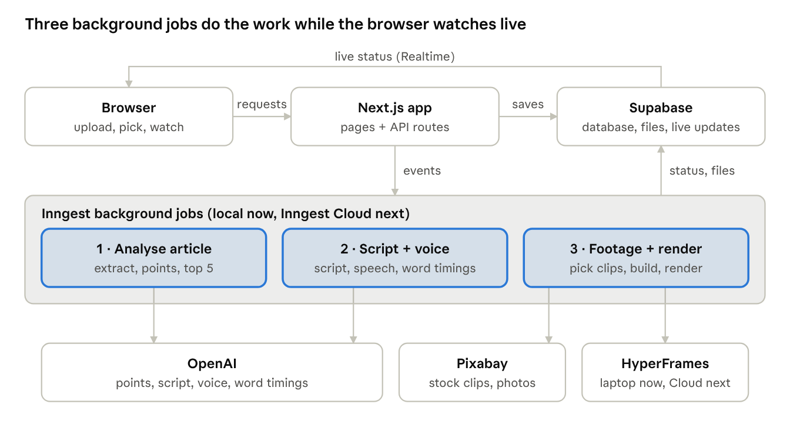

# ArticL — Product One-Pager v2

Nov 19, 2026 · Amir

> Exported from the Claude Doc: https://claude.ai/artifact/KQ5wC5rqDrxRFDzuuvuN8E (the live, editable version). PDF copy: `ArticL-Product-One-Pager-v2.pdf`.

ArticL turns an academic article (PDF or pasted text) into a 50-second Instagram-Reels-style video that explains its findings in everyday language. The prototype works end to end today: upload → 5 recommended points → script → voice → captions → stock footage → MP4.

The product is split into three parts, each with its own goal and owner of quality:

1. **Article analysis** — understand the article correctly and choose what matters for a short video.
2. **Video creation** — turn those points into the best possible hooky, fast, plain-language reel, as fast and cheaply as possible.
3. **Frontend and user experience** — make the few minutes of production feel interactive, not like waiting.

**Measured on 2026-11-19** (Margalit & Shayo 2021, a 20-page, 13,165-word paper):

| Measure | Today |
| --- | --- |
| Upload → points checklist | 19 s |
| Continue → finished video | 5 min (render alone 3 min 53 s) |
| Video | 49.8 s, 1080×1920, 16 shots (13 clips, 3 photos), 24 MB |
| Cost per video | ≈ $0.02 (OpenAI only; Pixabay and local render are free) |

## Part 1 — Article analysis

**Goal:** understand the article correctly, split it into meaningful sections, and pick the findings that work in a 60-second video — with every number traceable to the article.

**Today:** text is extracted from the PDF (or pasted), cleaned, and the reference list is cut. One AI call proposes 12–15 candidate points (stat, quote or claim), each with a sentence copied from the article; any point whose sentence or numbers aren't really in the text is dropped. The AI also pre-selects the best 5. On the Margalit paper, 13 of 15 points passed the check.

**Gaps:**

- No real understanding of structure: the AI reads one long text, not sections (abstract, method, findings, limitations), so it can pick a method detail over a headline finding.
- No overall "what is this paper about" summary that the script and visuals could build on.
- Scanned PDFs fail (no OCR); tables and two-column layouts are only partly handled.
- Long articles: anything past ~30,000 words is refused; no chunking yet.

**Next phase:** add an **article map** step before the points — section by section: research question, method, key findings, limitations, plus a one-paragraph plain summary. Points are then picked from the findings, and the script reuses the map.

| Step | Tool today | Next phase |
| --- | --- | --- |
| PDF text extraction | unpdf (in the app) | Keep; add an OCR fallback for scanned PDFs (tool to choose) |
| Cleaning, reference-list cut | Own code | Detect sections (headings) for the article map |
| Point proposal + top-5 pick | OpenAI gpt-5-mini (~$0.007/article) | Revisit gpt-5-nano after the prototype (~5× cheaper, weaker in tests) |
| Fact check of points | Own code: quoted sentence and numbers must be in the text | Keep |
| Storage of PDFs and text | Supabase Storage + Postgres | Keep |

## Part 2 — Video creation

**Goal:** the best possible reel for the format — a hook in the first seconds, fast cuts, the findings told at eye level in everyday words — while keeping each video around a few cents and a few minutes.

**Today:**

1. **Script:** a hook, one beat per chosen point and a closing line, ≤ 150 words (≤ 60 s). Rules force plain spoken English, digits for numbers, and no number that isn't in the chosen points; a failing script is rewritten.
2. **Voice:** one clip per part, read at 1.1× speed.
3. **Captions:** word timings from the audio, shown with the script's own spelling ("7.5", not "7 5"), 3 words at a time with the spoken word highlighted.
4. **Visuals:** about 3-second shots cut on caption breaks; each shot gets a stock video clip (or photo) found from a short search the script step writes, checked against the clip's tags. Varied motion, cross-fades, and big-number callouts ("7.5 percentage points").
5. **Render:** built as an HTML video and rendered on this computer at draft quality.

**Gaps:**

- About 3 of 16 clips miss the meaning (a "Happy Birthday" banner for "party banners"); the tag check can't tell word senses apart.
- Plain language is asked for but not measured; study jargon ("asset treatment") still slips in sometimes.
- No music or sound design; the voice has not been compared with newer voices.
- Rendering only works on this laptop, not on a server.

**Next phase:** switch to cloud rendering before deploying; add an AI check that picks the clip best matching each sentence (deferred, est. $0.002–0.004/video); add a plain-language check on the script; decide on music.

| Step | Tool today | Next phase |
| --- | --- | --- |
| Script writing + checks | OpenAI gpt-5-mini (~$0.001) + own rules | Add plain-language check; same model review after prototype |
| Voiceover | OpenAI TTS tts-1, voice "nova", 1.1× (~$0.014) | Compare with newer voices (open question) |
| Word timings | OpenAI Whisper (~$0.005), aligned to the script | Keep |
| Stock footage | Pixabay video + photo API, 1080p clips, tag filter (free) | Optional AI clip pick |
| Composition | HyperFrames 0.9.67 (HTML + GSAP animation) | Keep |
| Render | HyperFrames CLI on this laptop, draft quality (free, ~4 min) | **HyperFrames Cloud** (~$0.10/video, estimate from the first one-pager, not yet checked) |
| Media storage | Supabase Storage, private "media" bucket (voice, photos, final MP4) | Supabase Pro once past the 1 GB free tier (~40 videos at 24 MB) |

## Part 3 — Frontend and user experience

**Goal:** the user should never feel they uploaded a file and are now waiting several minutes. Every stage should show something new, and the user should have something worth doing while the video is made.

**Today:** upload a PDF or paste text → a job page (`/jobs/<id>`) that survives a refresh → the 5 recommended points arrive pre-ticked (adjust or just continue) → a 4-step progress line (script, voice, footage, render) with a render % bar → the script and its voice clips can be played while the video renders → video player, download and footage credits. A "My videos" list shows the 20 latest jobs with live status.

**Gaps:**

- The last ~4 minutes are mostly a progress bar: nothing visual appears until the MP4 is done.
- No way to act during the wait or after: no editing a script line, swapping a clip, changing the voice, or re-rendering.
- No notification when the video is ready; the tab has to stay open to notice.
- No sign-in: every user sees every job; no delete.
- Not yet tested on a phone.

**Next phase — make the wait active:**

- Show the work as it happens: script lines appear as written; a **storyboard** fills in shot by shot with clip thumbnails as footage is picked.
- **Instant preview:** the video is built as an HTML page before it's rendered, so it could play in the browser seconds after the footage is picked, while the MP4 renders (feasibility not yet checked).
- Let the user steer during the wait: swap a clip, edit a line, then re-render only what changed.
- Notify when done (browser notification, later email).
- Sign-in so each user sees only their own videos.

| Area | Tool today | Next phase |
| --- | --- | --- |
| Web app | Next.js 16 + React 19 + Tailwind 4, run locally | Deploy to Vercel |
| Live status | Supabase Realtime + 3-second polling fallback | Keep; push storyboard and script progress the same way |
| Job list and pages | Supabase Postgres (`jobs` table, read-all policy for the prototype) | Supabase Auth + per-user access rules |
| Uploads | Browser → Supabase Storage via one-time signed link (20 MB limit) | Keep |
| Video playback / download | Supabase signed links (1 hour) | Keep; add share links |

## Shared platform and next-phase changes

All three parts run on one small stack; moving off this laptop is the main change before anyone else can use ArticL.

The browser never waits on a request: it starts a job, then follows its status live while the three background jobs call out to OpenAI, Pixabay and HyperFrames.

| Area | Today | Before sharing with others |
| --- | --- | --- |
| Hosting | Local dev server | Vercel |
| Background jobs | Inngest dev server on the laptop | Inngest Cloud (free at this scale, per the first one-pager) |
| Video render | HyperFrames CLI on the laptop | HyperFrames Cloud (needs a HeyGen account) |
| Database + files | Supabase free tier (1 GB storage) | Supabase Pro ($25/month, per the first one-pager) |
| Sign-in | None; every job visible to all | Supabase Auth, per-user access |
| Keys | Repo-root `.env` | Vercel environment variables |

## Open questions

These change what each part should optimise for; answers can go in a comment on each line.

- [ ] **Who is the user?** Researchers promoting their own papers, students, journalists, or a general audience? This sets the tone and how simple the language must be.
- [ ] **Credit the source in the video?** An end card with authors, year and journal/DOI would make clips citable and honest; today the video never names the paper.
- [ ] **Languages:** English only, or also Hebrew (voice, right-to-left captions, stock-search terms)?
- [ ] **Script review:** keep point selection as the only approval step, or let users read and edit the script before rendering (more control, one more step)?
- [ ] **Where do videos go?** Download only, or post straight to Instagram/TikTok/YouTube Shorts (each has different on-screen safe areas)?
- [ ] **Sound and look:** background music? A choice of voices? Your own branding (logo, colours, outro)?
- [ ] **Length:** always ~50–60 s, or let the user choose (e.g. 30 / 60 / 90 s)?
- [ ] **Inputs:** also article links (web pages, DOI), not just PDFs and pasted text?
- [ ] **Budget per video:** cloud rendering (~$0.10) will be most of the cost; what is the ceiling, and will users pay?
- [ ] **Accounts:** single users, or shared team workspaces?
